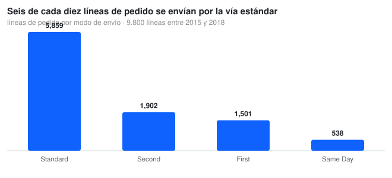
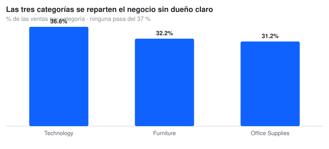
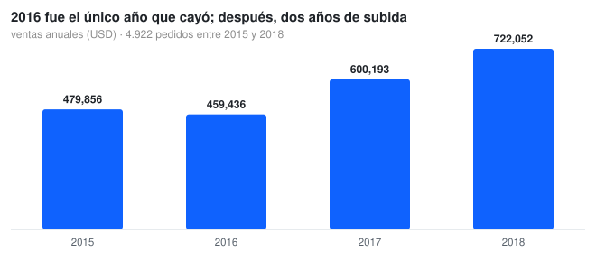

# 🏪 Global Store Retail Analysis — Star Schema on Fabric

**Enterprise BI Solution | PySpark ETL | Star Schema | Power BI Dashboard**

[](https://fabric.microsoft.com/)
[](https://spark.apache.org/)
[](https://powerbi.microsoft.com/)
[](https://opensource.org/licenses/MIT)

---

## 📋 Overview

A retail Star Schema on Microsoft Fabric: PySpark cleans a messy sales file and writes Delta tables (`Fact_Sales` plus four dimensions), and Power BI consumes them. The interesting part is not the pipeline, it is that **the data decides what the business question can be**, and the numbers below come from the versioned `train.csv` — `src/globalstore_charts.py` regenerates every chart from it.

---

## 🎯 The business question

**Where is this retailer actually exposed — in what it sells, or in how it ships?**

A store that sells three categories in equal parts has no single product bet to defend, and its risk sits somewhere else: operations. That is the question this dataset can answer with evidence, and the answer changes which dashboard matters.



---

## 📊 What the data says

### Six out of ten order lines ship by the standard route

**5,859 lines (59.8 %) Standard Class**, 1,902 Second Class (19.4 %), 1,501 First Class (15.3 %) and 538 Same Day (5.5 %). Operations are concentrated in one mode, so a carrier or SLA problem in Standard Class touches six of every ten order lines — and Same Day, the mode customers notice most, is a 5 % niche.

### The three categories split the business with no clear owner



**Technology 36.6 %**, Furniture 32.2 %, Office Supplies 31.2 % of sales. A spread that flat means no category can be cut without losing a third of revenue, and no category is big enough to justify focusing the whole strategy on it. The lever has to be margin or operations, not assortment.

### 2016 was the only year that fell; then two years of growth



479,856 → **459,436 (−4.3 %)** → 600,193 (+30.6 %) → 722,052 (+20.3 %). Four complete years, 48 months, **2,261,536.78 USD** in sales and a **230.77 USD** average line value.

### The dashboard


---

## 🛠️ Technical stack

| Category | Technologies |
| :--- | :--- |
| **Platform** | Microsoft Fabric |
| **Data Engineering** | PySpark, Dataflows Gen2 |
| **Data Storage** | Delta Lake (versioned) |
| **Data Modeling** | Star Schema (Fact/Dimensions) |
| **BI & Analytics** | Power BI, DAX |

---

## 🏗️ Architecture

```
RAW      train.csv — 9,800 order lines, 2015-2018, day/month/year dates
ETL      ETL_Analysis.py — column names, types, null and duplicate resolution
MODEL    Fact_Sales + Dim_Product, Dim_customer, Dim_Geography, Dim_Date
STORAGE  Delta tables under Tables/ (ACID, versioned)
BI       Power BI: DAX measures and the dashboard above
```

| Table | Grain / key |
| :--- | :--- |
| **Fact_Sales** | one row per order line: `Row_ID`, `Order_ID`, dates, `Ship_Mode`, `Customer_ID`, `Product_ID`, `Sales`, `Postal_Code` |
| **Dim_Product** | one row per `Product_ID` (category, sub-category, name) |
| **Dim_customer** | unique `Customer_ID` with segment |
| **Dim_Geography** | one row per `Postal_Code` (country, city, state, region) |
| **Dim_Date** | one row per order date (year, month name, quarter, weekday) |

There is **no** `Dim_Store`: this dataset has no store identifier, only a shipping destination. Inventing one would have meant inventing a dimension.

---

## ⚠️ The bug worth knowing about

`Order Date` looks like `08/11/2017`, and the ETL originally parsed it as `MM/dd/yyyy`. In Spark that does not raise: it returns **null** for every row where the first field is above 12. With the real format (`dd/MM/yyyy`) the file has **0 unreadable dates**; with the month-first reading, **5,841 of 9,800 rows (60 %) lose their date silently** — and with them the whole time dimension and every trend visual.

The script now parses `dd/MM/yyyy` and the notebook asserts that no date is left unparsed before aggregating.

---

## 📁 Project structure

```
Tech_GlobalStore_Retail_Analysis-Fabric/
├── train.csv                                  raw sales file (9,800 lines)
├── ETL_Analysis.py                            PySpark ETL: dimensions + fact + charts
├── notebooks/globalstore_retail_colab.ipynb   pandas walkthrough, reads train.csv from GitHub
├── src/globalstore_charts.py                  the three charts in this README (SVG)
├── src/svg_chart.py                           dependency-free SVG bar chart generator
├── docs/img/*.svg                             charts used here
├── docs/PLAN.md, docs/report.html             plan and one-page report
├── stack-abierto/                             open-source stack version (SQL + run.py)
└── Dashboard Global Store.png                 Power BI dashboard
```

---

## ▶️ Reproduce it

```bash
git clone https://github.com/Nicolenki7/Tech_GlobalStore_Retail_Analysis-Fabric.git
cd Tech_GlobalStore_Retail_Analysis-Fabric

python -m venv .venv && source .venv/bin/activate
pip install -r requirements.txt

python src/globalstore_charts.py     # regenerates docs/img/*.svg from train.csv
```

`ETL_Analysis.py` needs a Spark session (Fabric or Databricks) and writes Delta tables; it is not runnable on a laptop as-is.

---

## 📏 Metrics

| Metric | Value |
| :--- | :--- |
| Order lines / orders / customers | **9,800 / 4,922 / 793** |
| Sales | **2,261,536.78 USD** |
| Average line value | **230.77 USD** |
| Period | **2015-01 → 2018-12** (48 months) |
| Ship mode share | **59.8 / 19.4 / 15.3 / 5.5 %** |
| Category share | **36.6 / 32.2 / 31.2 %** |
| Unreadable dates | **0** |

---

## 🚧 Limitations

- **No cost, margin or discount columns:** revenue can be described, profitability cannot.
- **No store dimension and no quantity:** the fact grain is order line, so "units sold" is not measurable here.
- **The dataset is a well-known retail sample** (US states, 2015-2018), not a client extraction; trends are illustrative of the data, not of a real retailer.
- **Shipping dates exist but no SLA definition**, so "late delivery" cannot be scored without inventing a threshold.

---

## 📝 Resumen en Español

Solución BI sobre Microsoft Fabric: **PySpark** limpia un archivo de ventas desordenado y escribe un **Star Schema** en Delta (`Fact_Sales` + `Dim_Product`, `Dim_customer`, `Dim_Geography`, `Dim_Date`), que consume **Power BI**.

Los números salen de `train.csv` y los regenera `src/globalstore_charts.py`: **9.800 líneas de pedido, 4.922 pedidos y 793 clientes** entre 2015 y 2018, con **2.261.536,78 USD** de ventas. Las tres categorías se reparten el negocio (36,6 / 32,2 / 31,2 %) mientras el **59,8 % de las líneas se envía por la vía estándar**: el riesgo está en operaciones, no en el surtido. Y un bug real corregido: el ETL parseaba las fechas como mes/día cuando el archivo viene en día/mes, lo que dejaba **5.841 de 9.800 filas sin fecha** sin ningún error visible.

---

## 🔗 Links

| Resource | URL |
| :--- | :--- |
| **Repository** | https://github.com/Nicolenki7/Tech_GlobalStore_Retail_Analysis-Fabric |
| **Live Dashboard** | [View in Fabric](https://app.fabric.microsoft.com/reportEmbed?reportId=ef628e11-1d49-421b-8a9d-b82867bf8d37) |

---

## 📄 License

MIT License — Feel free to fork, modify, and use for personal or commercial projects.

---

## 👤 Author

**Nicolás Zalazar** | Senior Data Engineer & Microsoft Fabric Specialist

- GitHub: [@Nicolenki7](https://github.com/Nicolenki7)
- LinkedIn: [nicolas-zalazar-63340923a](https://www.linkedin.com/in/nicolas-zalazar-63340923a)
- Portfolio: [nicolenki7.github.io/Portfolio](https://nicolenki7.github.io/Portfolio/)
- Email: zalazarn046@gmail.com
